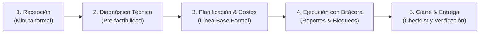

# SGCS: Sistema Multi-Tenant de Gestión de Configuración y Control Operativo

> Plataforma Web para la erradicación del «teléfono descompuesto» en la gestión de servicios técnicos, proyectos y operaciones mediante control estricto de requerimientos, pre-factibilidad técnica, líneas base inmutables y bitácoras diarias de bloqueos.

[](LICENSE)
[](https://nextjs.org/)
[](https://www.typescriptlang.org/)
[](https://tailwindcss.com/)
[](https://www.prisma.io/)
[](https://www.postgresql.org/)

---

## 📌 1. Visión del Proyecto

El término **«teléfono descompuesto»** describe la distorsión progresiva de la información cuando pasa de una persona a otra sin quedar formalmente registrada:
1. El cliente pide una necesidad de negocio.
2. Ventas o gerencia interpreta otra cosa y promete fechas de entrega o presupuestos irreales.
3. El equipo técnico especialista se entera al final, descubriendo que la solución es inviable por falta de insumos, accesos o tiempo.

Este sistema implementa un **patrón universal de 5 etapas** para asegurar que ninguna promesa al cliente sea suscrita sin la validación previa del especialista técnico:



---

## 🏢 2. Adaptabilidad Multi-Industria

A través de un motor **Multi-Tenant con Plantillas Configurables**, el software utiliza una sola base de código pero adapta su vocabulario y formularios dinámicos a cualquier rubro:

| Industria | Entidad Principal | Especialista Técnico | Documento Previo | Reporte Diario de Campo |
| :--- | :--- | :--- | :--- | :--- |
| **Software** | *Sprint / Proyecto* | Tech Lead / Arquitecto | Manual de marca, APIs | Commits, endpoints, bloqueos de API |
| **Veterinaria** | *Caso / Paciente* | Cirujano / Anestesista | Exámenes pre-quirúrgicos, ayuno | Signos vitales, dosis administrada |
| **Construcción** | *Obra / Reforma* | Ing. Civil / Arquitecto | Planos estructurales, licencias | Metros avanzados, sacos de cemento, fotos |

---

## 🛠️ 3. Stack Tecnológico

* **Frontend Web:** Next.js (App Router), React, Tailwind CSS, Shadcn UI / Radix UI, React Hook Form y Zod.
* **Backend API:** Next.js Server Actions y Route Handlers con TypeScript.
* **ORM:** Prisma ORM (modelado de datos tipo Eloquent, tipado seguro y transacciones ACID).
* **Base de Datos:** PostgreSQL con soporte relacional e híbrido en `JSONB`.
* **Seguridad:** Autenticación con Bcrypt (salt individual) y JWT en cookies `HttpOnly`, control de acceso basado en roles (RBAC) en servidor.
* **Pruebas Remotas:** Cloudflare Tunnel (`cloudflared`) para exponer el entorno local con SSL/HTTPS público de inmediato.

---

## 📚 4. Índice de Documentación Detallada

La documentación arquitectónica y técnica completa se encuentra en la carpeta [`/docs`](file:///C:/Users/Usuario/Desktop/Dev/projects/active/UTP/ProyectosClara/docs):

1. **[01. Visión y Alcance](file:///C:/Users/Usuario/Desktop/Dev/projects/active/UTP/ProyectosClara/docs/01-vision-y-alcance.md):** Fundamento del problema, casos de uso comparativos y modelo universal.
2. **[02. Especificación de Requerimientos](file:///C:/Users/Usuario/Desktop/Dev/projects/active/UTP/ProyectosClara/docs/02-requerimientos.md):** Catálogo formal de **RF-01 a RF-18** y **RNF-01 a RNF-12**.
3. **[03. Arquitectura Técnica](file:///C:/Users/Usuario/Desktop/Dev/projects/active/UTP/ProyectosClara/docs/03-arquitectura-tecnica.md):** Diseño en capas, seguridad de credenciales, roles y estrategia de túneles remotos.
4. **[04. Modelo de Base de Datos](file:///C:/Users/Usuario/Desktop/Dev/projects/active/UTP/ProyectosClara/docs/04-modelo-base-datos.md):** Diagrama Entidad-Relación (Mermaid), inmutabilidad de líneas base y auditoría.
5. **[05. Roadmap de Desarrollo](file:///C:/Users/Usuario/Desktop/Dev/projects/active/UTP/ProyectosClara/docs/05-roadmap-desarrollo.md):** Fases y tareas ordenadas para la implementación.

---

## 🚀 5. Puesta en Marcha Rápida (Local)

### Prerrequisitos
* Node.js v18 o superior
* Docker Desktop o una instancia activa de PostgreSQL
* Git

### Instalación
```bash
# Clonar el repositorio
git clone https://github.com/ClaraBQuispeChileno/G01_Gesti-n-de-la-Configuraci-n-de-S-ftware.git
cd G01_Gesti-n-de-la-Configuraci-n-de-S-ftware

# Instalar dependencias
npm install

# Configurar variables de entorno
cp .env.example .env

# Ejecutar migraciones de base de datos
npx prisma migrate dev --name init

# Iniciar servidor de desarrollo
npm run dev
```

La aplicación estará disponible localmente en `http://localhost:3000`.

### Pruebas Remotas con Celular / Otras PCs
```bash
cloudflared tunnel --url http://localhost:3000
```
