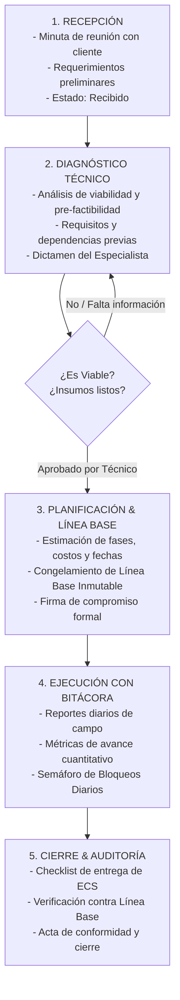

# 01. Visión y Alcance del Sistema

## 1. El Problema Raíz: «El Teléfono Descompuesto»

En las empresas de servicios y tecnología, la desconexión entre la venta comercial, la gestión gerencial y la ejecución técnica es la principal causa de sobrecostos, retrasos e insatisfacción de los clientes.

### Escenario Típico de Falla:
1. **El Cliente** describe una necesidad general con altas expectativas no cuantificadas.
2. **El Representante Comercial o Gerente** interpreta la solicitud sin rigor técnico y pacta un precio y una fecha de entrega fija antes de evaluar la viabilidad.
3. **El Equipo Especialista Técnico** (desarrolladores, ingenieros civiles, cirujanos veterinarios) se entera del compromiso cuando el contrato ya está firmado.
4. **Consecuencia:** Se descubre que faltan requerimientos previos esenciales (manuales de marca, credenciales API, planos estructurales, estudios clínicos o permisos legales), haciendo inviable el cumplimiento de la promesa.

---

## 2. La Solución: El Flujo Universal de 5 Etapas

El sistema elimina este problema implementando un **bloqueo estricto por etapas**: ninguna promesa ni fecha puede formalizarse sin la aprobación documentada del especialista técnico.

---

## 3. Modelo Agnóstico y Adaptabilidad Multi-Industria

El sistema no depende de la industria porque **el patrón de servicio por etapas es universal**. La plataforma opera bajo un modelo **Multi-Tenant** donde cada organización elige una plantilla al darse de alta.

### Comparativa Transversal por Industria:

| Etapa Operativa | 💻 Empresa de Software | 🐾 Clínica Veterinaria (Cirugías) | 🏗️ Empresa de Construcción |
| :--- | :--- | :--- | :--- |
| **1. Recepción** | Reunión de levantamiento para una plataforma de cursos web. | Consulta inicial para cirugía compleja de cadera. | Solicitud de remodelación integral de oficinas comerciales. |
| **2. Diagnóstico Técnico** | Arquitecto de software exige APIs de pago y UI/UX pide manual de marca. | Cirujano y anestesista exigen analíticas de sangre, radiografías y ayuno. | Ing. Civil exige planos estructurales y cálculo de cargas eléctricas. |
| **3. Planificación & Costos** | Fases (2 sem. prototipos, 3 sem. backend, 2 sem. QA). Línea base aprobada. | Fases (1: Pre-quirúrgico, 2: Cirugía, 3: Cuidados intensivos). | Fases (Demolición, cableado/plomería, acabados, inspección). |
| **4. Reporte Diario** | Commits realizados, endpoints listos, bloqueos: *«API del cliente no responde»*. | Temperatura, medicación, apetito, bloqueos: *«Animal presenta fiebre postoperatoria»*. | $m^2$ revocados, sacos consumidos, bloqueos: *«Retraso de entrega de pintura»*. |
| **5. Cierre** | Despliegue en producción y entrega de código fuente documentado. | Alta médica del paciente con indicaciones y receta de recuperación. | Acta de recepción de obra terminada e inspección de acabados. |

---

## 4. Filosofía del Aislamiento de Datos

Cada empresa (inquilino / tenant) está estrictamente aislada:
- Los términos que ve el usuario final son los de su propio rubro (un médico veterinario nunca verá términos como *«commits»* o *«planos»*).
- Los datos de cada empresa no pueden ser leídos ni modificados por otra empresa bajo ninguna circunstancia.
