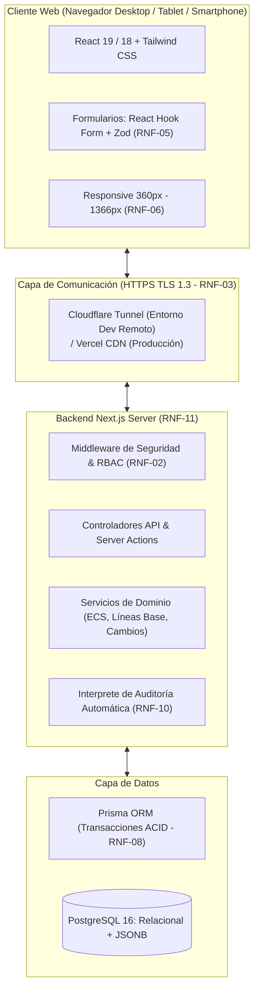
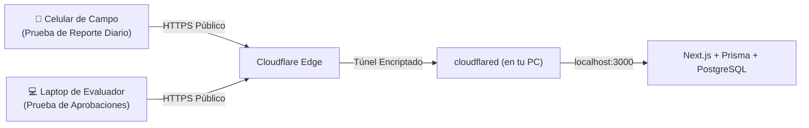

# 03. Arquitectura Técnica del Sistema

## 1. Visión General de la Arquitectura

El sistema está concebido como una **aplicación web moderna Fullstack** en un solo repositorio (*Monorepo*), utilizando **Next.js (App Router)** para unificar la interfaz de usuario reactiva y la API REST en el mismo proceso de servidor.



---

## 2. Aislamiento Multi-Tenant (Seguridad RNF-02)

Para garantizar que los clientes de diferentes industrias (software, veterinaria, construcción) no vean ni interfieran con los datos de otras organizaciones:

1. **Inyección de Tenant Automática:**
   El token de autenticación (JWT) contiene el identificador de la organización (`organizacion_id`).
2. **Scoping de Consultas:**
   Toda consulta a través de Prisma incluye obligatoriamente la cláusula:
   ```typescript
   where: {
     organizacion_id: session.organizacionId,
     // filtros adicionales...
   }
   ```
3. **Rechazo por URL Directa (RNF-02):**
   Si un usuario manipula la URL para consultar un ID de otra empresa, la consulta devuelve `null` y el servidor emite una respuesta `404 Not Found` o `403 Forbidden`.

---

## 3. Seguridad de Acceso y Credenciales (RNF-01 y RNF-02)

* **Hashing:** Se utiliza `bcrypt` con un factor de costo de 12 y salt criptográfica individual para cada contraseña.
* **Sesión:** Al autenticar con éxito, se emite un JWT firmado almacenado en una cookie con atributos:
  * `HttpOnly = true` (Inaccesible desde JavaScript, previene ataques XSS).
  * `Secure = true` (Solo se transmite por HTTPS).
  * `SameSite = 'lax'` (Protección contra CSRF).
* **Control de Acceso Basado en Roles (RBAC):**
  * `SUPERADMIN`: Control maestro de organizaciones y plantillas de industria.
  * `ADMINISTRADOR`: Gestión de usuarios de su propia empresa y configuraciones.
  * `APROBADOR`: Rol técnico facultado para aprobar versiones y dictaminar solicitudes de cambio.
  * `SOLICITANTE`: Operador autorizado para registrar solicitudes de cambio y reportes diarios.

---

## 4. Prisma ORM: Filosofía de Consulta y Transacciones ACID (RNF-08)

Prisma ORM proporciona una interfaz declarativa similar a Eloquent de Laravel pero con tipado estricto en tiempo de compilación.

### Ejemplo: Transacción para Establecer una Línea Base (RF-09, RNF-08)
```typescript
await prisma.$transaction(async (tx) => {
  // 1. Crear el encabezado de la línea base
  const lineaBase = await tx.lineaBase.create({
    data: {
      codigo: 'LB-PROY-01',
      nombre: 'Línea Base Contractual',
      proyecto_id: proyectoId,
      autor_id: userId,
    },
  });

  // 2. Asociar únicamente versiones en estado APROBADA
  const relaciones = versionesAprobadasIds.map((versionId) => ({
    linea_base_id: lineaBase.id,
    version_ecs_id: versionId,
  }));

  await tx.lineaBaseVersiones.createMany({
    data: relaciones,
  });

  // 3. Registrar auditoría obligatoria (RNF-10)
  await tx.auditoriaLog.create({
    data: {
      usuario_id: userId,
      accion: 'ESTABLECER_LINEA_BASE',
      entidad: 'LINEA_BASE',
      entidad_id: lineaBase.id,
      detalles: { total_versiones: versionesAprobadasIds.length },
    },
  });
});
```
Si cualquier paso falla, la transacción revierte todos los cambios automáticamente.

---

## 5. Pruebas Remotas con Cloudflare Tunnel

Para permitir pruebas concurrentes desde múltiples PCs, tablets o celulares de evaluadores sin costos de despliegue:



Comando de activación:
```bash
cloudflared tunnel --url http://localhost:3000
```
Provee una URL segura pública (ejemplo: `https://mi-sgcs.trycloudflare.com`) cumpliendo el requisito **RNF-03 (HTTPS)** de forma inmediata.
