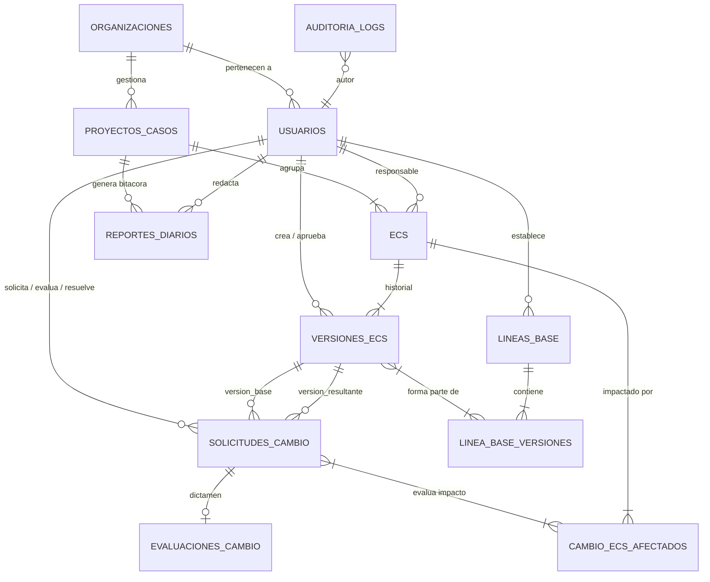

# 04. Modelo de Base de Datos (PostgreSQL)

## 1. Diagrama Entidad-Relación Integral

---

## 2. Diccionario de Tablas del Sistema

### 1. `organizaciones` (Multi-Tenancy y Plantillas)
Alberga las empresas cliente y su configuración de vocabulario.
* `id` (UUID, PK)
* `nombre` (VARCHAR 150)
* `rubro` (ENUM: `SOFTWARE`, `VETERINARIA`, `CONSTRUCCION`, `OTRO`)
* `configuracion_terminologia` (JSONB): Mapeo de términos personalizados.
* `activo` (BOOLEAN, default: true)
* `created_at`, `updated_at` (TIMESTAMP)

### 2. `usuarios` (RF-01, RF-02, RF-03, RNF-01)
* `id` (UUID, PK)
* `organizacion_id` (UUID, FK a `organizaciones`)
* `nombre_completo` (VARCHAR 150)
* `email` (VARCHAR 150, UNIQUE por organización)
* `password_hash` (VARCHAR 255 - Bcrypt con salt individual)
* `rol` (ENUM: `SUPERADMIN`, `ADMINISTRADOR`, `APROBADOR`, `SOLICITANTE`)
* `activo` (BOOLEAN, default: true)
* `created_at`, `updated_at` (TIMESTAMP)

### 3. `proyectos_casos` (Contenedor de Trabajo)
* `id` (UUID, PK)
* `organizacion_id` (UUID, FK)
* `codigo` (VARCHAR 50, UNIQUE por organización)
* `nombre` (VARCHAR 200)
* `cliente_nombre` (VARCHAR 150)
* `fecha_inicio` (DATE)
* `fecha_estimada_fin` (DATE NULL - establecida tras evaluación técnica)
* `estado` (ENUM: `DIAGNOSTICO`, `PLANIFICACION`, `EN_EJECUCION`, `CONGELADO`, `CERRADO`)
* `created_at`, `updated_at` (TIMESTAMP)

### 4. `ecs` (Elementos de Configuración - RF-04, RF-05, RF-06)
* `id` (UUID, PK)
* `proyecto_id` (UUID, FK a `proyectos_casos`)
* `codigo` (VARCHAR 50, UNIQUE dentro del proyecto)
* `nombre` (VARCHAR 200)
* `tipo` (ENUM: `DOCUMENTO`, `CODIGO_FUENTE`, `DISENO`, `BASE_DATOS`, `CASO_PRUEBA`, `OTRO`)
* `descripcion` (TEXT)
* `ubicacion` (VARCHAR 500 - ruta física, repo o enlace)
* `responsable_id` (UUID, FK a `usuarios`)
* `atributos_personalizados` (JSONB - datos específicos de industria)
* `estado` (ENUM: `ACTIVO`, `DEPRECADO`)
* `created_at`, `updated_at` (TIMESTAMP)

### 5. `versiones_ecs` (RF-07, RF-08)
* `id` (UUID, PK)
* `ecs_id` (UUID, FK a `ecs`)
* `numero_version` (VARCHAR 30 - ej: `1.0.0`, único por ECS)
* `descripcion` (TEXT)
* `archivo_url` (VARCHAR 500)
* `estado` (ENUM: `PENDIENTE`, `APROBADA`, `RECHAZADA`)
* `autor_id` (UUID, FK a `usuarios`)
* `aprobador_id` (UUID NULL, FK a `usuarios`)
* `fecha_aprobacion` (TIMESTAMP NULL)
* `created_at` (TIMESTAMP)
* *Constraint:* `UNIQUE(ecs_id, numero_version)`

### 6. `lineas_base` & `linea_base_versiones` (Inmutables - RF-09, RF-10)
* `lineas_base`:
  * `id` (UUID, PK)
  * `proyecto_id` (UUID, FK)
  * `codigo` (VARCHAR 50, UNIQUE)
  * `nombre` (VARCHAR 200)
  * `descripcion` (TEXT)
  * `autor_id` (UUID, FK)
  * `estado` (ENUM: `VIGENTE`, `OBSOLETA`)
  * `created_at` (TIMESTAMP)
* `linea_base_versiones`:
  * `linea_base_id` (UUID, FK a `lineas_base`)
  * `version_ecs_id` (UUID, FK a `versiones_ecs` con `estado = 'APROBADA'`)
  * *PK Compuesta:* `(linea_base_id, version_ecs_id)`
  * *Regla:* Una vez insertados, son de **solo lectura**. Las modificaciones conllevan a una nueva línea base.

### 7. `solicitudes_cambio` (RFC - RF-11, RF-12, RF-14, RF-15)
* `id` (UUID, PK)
* `codigo` (VARCHAR 50, UNIQUE)
* `ecs_id` (UUID, FK a `ecs`)
* `version_base_id` (UUID, FK a `versiones_ecs`)
* `version_resultante_id` (UUID NULL, FK a `versiones_ecs`)
* `descripcion` (TEXT)
* `justificacion` (TEXT)
* `estado` (ENUM: `PENDIENTE_EVALUACION`, `EN_EVALUACION`, `APROBADA`, `RECHAZADA`, `IMPLEMENTADA`)
* `solicitante_id` (UUID, FK a `usuarios`)
* `resolutor_id` (UUID NULL, FK a `usuarios`)
* `resolucion_justificacion` (TEXT NULL)
* `fecha_resolucion` (TIMESTAMP NULL)
* `created_at`, `updated_at` (TIMESTAMP)

### 8. `evaluaciones_cambio` & `cambio_ecs_afectados` (RF-13, RF-17)
* `evaluaciones_cambio`:
  * `id` (UUID, PK)
  * `solicitud_id` (UUID UNIQUE, FK a `solicitudes_cambio`)
  * `impacto` (ENUM: `BAJO`, `MEDIO`, `ALTO`, `CRITICO`)
  * `observaciones` (TEXT)
  * `evaluador_id` (UUID, FK a `usuarios`)
  * `created_at` (TIMESTAMP)
* `cambio_ecs_afectados`:
  * `solicitud_id` (UUID, FK a `solicitudes_cambio`)
  * `ecs_id` (UUID, FK a `ecs`)
  * *PK Compuesta:* `(solicitud_id, ecs_id)`

### 9. `reportes_diarios` (Bitácora de Campo y Alerta de Bloqueos)
* `id` (UUID, PK)
* `proyecto_id` (UUID, FK a `proyectos_casos`)
* `usuario_id` (UUID, FK a `usuarios`)
* `fecha` (DATE DEFAULT CURRENT_DATE)
* `resumen_actividades` (TEXT)
* `metricas_avance` (JSONB)
* `tiene_bloqueo` (BOOLEAN DEFAULT FALSE)
* `detalle_bloqueo` (TEXT NULL)
* `evidencias_urls` (TEXT[])
* `created_at` (TIMESTAMP)

### 10. `auditoria_logs` (Inmutable Append-Only - RF-16, RNF-10)
* `id` (BIGSERIAL, PK)
* `usuario_id` (UUID NULL, FK)
* `accion` (VARCHAR 100)
* `entidad` (VARCHAR 50)
* `entidad_id` (VARCHAR 100)
* `datos_anteriores` (JSONB NULL)
* `datos_nuevos` (JSONB NULL)
* `ip_address` (VARCHAR 45)
* `user_agent` (VARCHAR 255)
* `created_at` (TIMESTAMP DEFAULT CURRENT_TIMESTAMP)
* *Regla de Seguridad:* Esta tabla cuenta con restricción de denegación absoluta para sentencias `UPDATE` y `DELETE`.
