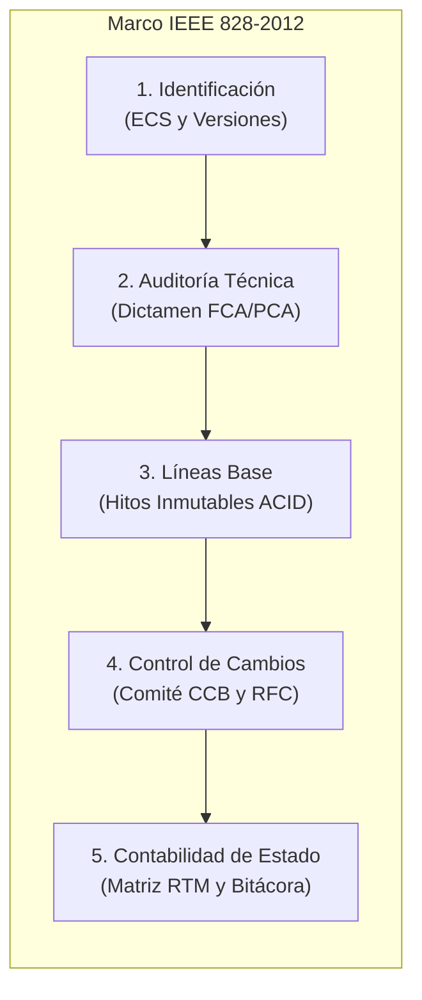
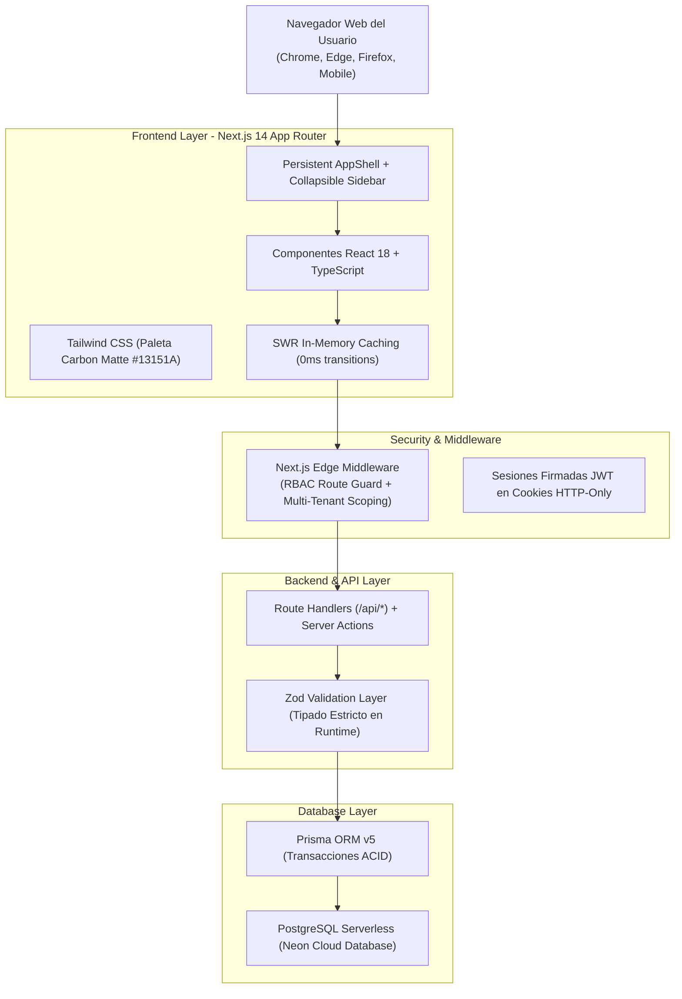
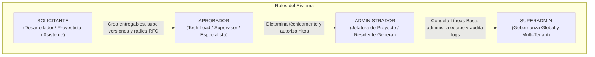
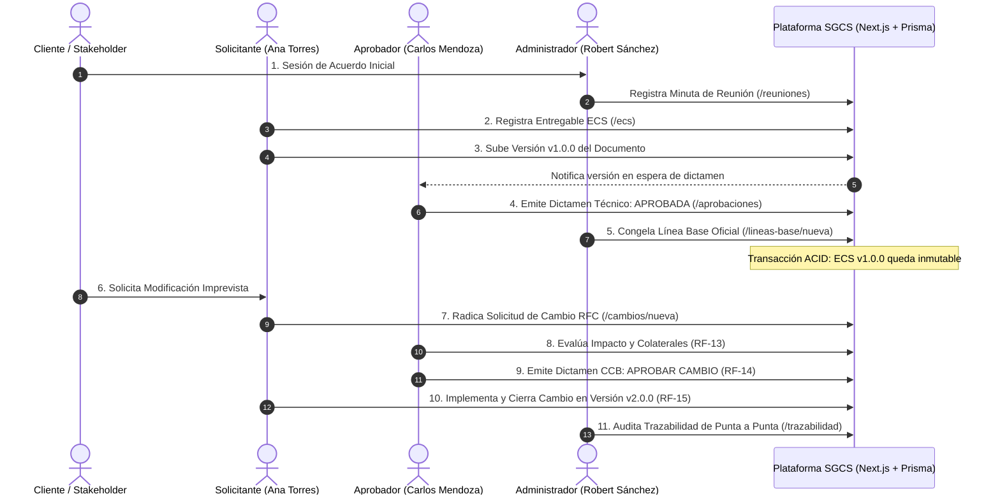
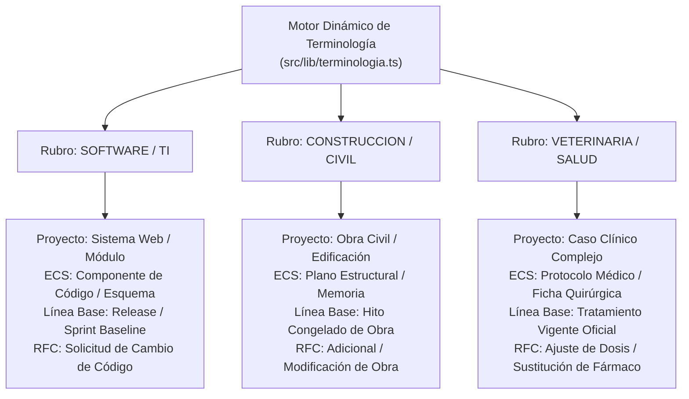
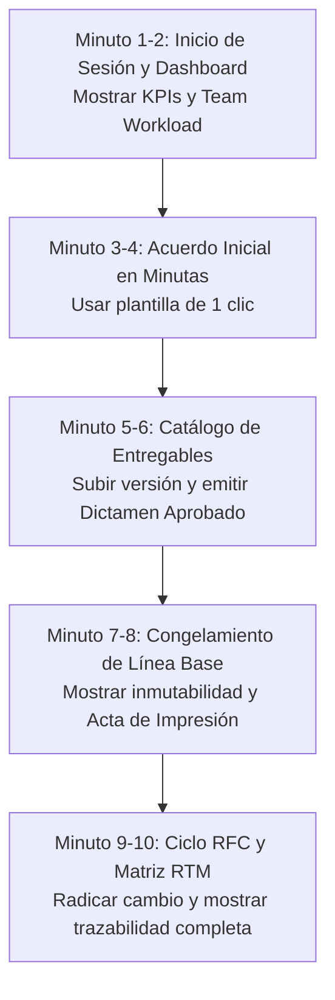

# Sustentación Técnica: Sistema de Gestión de Configuración de Software y Entregables Técnicos (SGCS)

> [!NOTE] Ficha Informativa del Proyecto
> * **Autora y Desarrolladora:** Clara B. Quispe Chileno
> * **Casa de Estudios:** Universidad Tecnológica del Perú (UTP)
> * **Asignatura:** Gestión de la Configuración de Software
> * **Repositorio Oficial:** [GitHub - ClaraBQuispeChileno / G01_Gesti-n-de-la-Configuraci-n-de-S-ftware](https://github.com/ClaraBQuispeChileno/G01_Gesti-n-de-la-Configuraci-n-de-S-ftware)
> * **Arquitectura:** Web Fullstack Serverless, Next.js 14 App Router, PostgreSQL Neon, Prisma ORM, TypeScript.

---

## 1. Introducción y Planteamiento del Problema

En la industria del desarrollo de software y en proyectos multidisciplinarios de ingeniería, uno de los factores críticos de sobrecosto, retraso y litigio es la ausencia de una cadena de custodia estricta sobre los productos de trabajo. Este fenómeno, comúnmente conocido como el problema del "teléfono descompuesto", se manifiesta a través de:

1. **Construcción o despliegue sobre versiones obsoletas:** Miembros del equipo que trabajan sobre planos, diagramas o código fuente desactualizados porque no existe una referencia congelada oficial.
2. **Modificaciones arbitrarias no costeadas:** Cambios solicitados verbalmente por clientes o partes interesadas que se ejecutan sin análisis de impacto técnico ni aprobación económica.
3. **Pérdida de trazabilidad y falta de rendición de cuentas:** Imposibilidad de determinar quién autorizó una modificación, en qué fecha, bajo qué justificación y qué componentes colaterales resultaron afectados.

### 1.1 Objetivo General
Diseñar e implementar una plataforma tecnológica robusta de gobernanza que aplique de forma automatizada las directrices de Gestión de la Configuración, asegurando que ningún entregable sea alterado sin un flujo formal de control de cambios, que cada hito cuente con respaldo transaccional inmutable (ACID), y que la información fluya con absoluta trazabilidad desde el acuerdo inicial hasta el despliegue final.

---

## 2. Marco Metodológico y Estándares Aplicados

La plataforma no constituye un gestor de tareas genérico, sino la materialización en código de los estándares internacionales más exigentes de la ingeniería de software y sistemas.

### 2.1 Estándar Internacional IEEE 828-2012
El estándar *IEEE 828-2012: Standard for Configuration Management in Systems and Software Engineering* define los cinco procesos esenciales que estructuran la arquitectura del sistema:

1. **Identificación de la Configuración (Configuration Identification):**  
   Selección y catalogación de los Elementos de Configuración del Software (ECS / Configuration Items). Cada artefacto posee un identificador inmutable en base de datos, un código semántico correlativo (ej. `PLN-001`, `MOD-PAGOS-01`), metadatos de autoría, ubicación de repositorio y un esquema de versionado incremental (`v1.0.0`, `v1.1.0`).

2. **Auditoría y Revisión de la Configuración (Configuration Audits - FCA / PCA):**  
   Inspección rigurosa previa a la incorporación de un artefacto a una versión de entrega. El sistema implementa la bandeja de Dictamen Formal donde los roles de supervisión realizan la Auditoría de Configuración Funcional (FCA) y Física (PCA), decidiendo formalmente la aprobación o rechazo del elemento.

3. **Gestión de Líneas Base (Baseline Management):**  
   Una Línea Base representa una especificación o producto que ha sido formalmente acordado, que sirve como base para desarrollos posteriores y que puede ser modificado únicamente a través de procedimientos formales de control de cambios. El sistema asegura la inmutabilidad de la Línea Base mediante transacciones ACID a nivel de base de datos relacional.

4. **Control de Cambios de la Configuración (Configuration Change Control):**  
   Procedimiento formal para procesar Solicitudes de Cambio (RFC - Request For Change). El flujo exige:
   * Radicación formal del requerimiento con justificación operativa.
   * Análisis técnico de impacto y selección de ECS colateralmente afectados.
   * Veredicto formal emitido por el Comité de Control de Cambios (CCB - Change Control Board).
   * Implementación vinculada a una versión resultante del artefacto.

5. **Contabilidad del Estado de la Configuración (Configuration Status Accounting - CSA):**  
   Registro y reporte continuo de la trazabilidad del producto. En el sistema se refleja mediante la Matriz de Trazabilidad de Requisitos (RTM) y la bitácora cronológica inmutable de auditoría.

### 2.2 Modelo de Madurez CMMI-DEV (Niveles 2 y 3)
La solución da cumplimiento a las Metas Específicas (SG) y Prácticas Específicas (SP) del Área de Proceso **Configuration Management (CM)**:
* **SG 1 Establecer Líneas Base:** Identificar los elementos de configuración, establecer un sistema de gestión de configuración y crear o liberar líneas base.
* **SG 2 Rastrear y Controlar los Cambios:** Rastrear solicitudes de cambio, controlar elementos de configuración e implementar trazabilidad bidireccional.
* **SG 3 Establecer la Integridad:** Establecer registros de gestión de configuración y realizar auditorías de configuración periódicas.

---

## 3. Stack Tecnológico y Arquitectura de Software

La solución ha sido construida siguiendo las mejores prácticas de la arquitectura moderna de aplicaciones empresariales.

### 3.1 Tecnologías Principales y Justificación Técnica

| Componente | Tecnología | Versión | Justificación Técnica |
| :--- | :--- | :--- | :--- |
| **Framework Base** | Next.js (App Router) | 14.2+ | Renderizado híbrido (SSR/CSR), optimización nativa de empaquetado, enrutamiento tipado y Server Actions. |
| **Lenguaje** | TypeScript | 5.0+ | Tipado estático de extremo a extremo, prevención de errores de nulabilidad y autocompletado en entidades de dominio. |
| **Capa Visual** | Tailwind CSS | 3.4+ | Sistema de diseño atómico utilitario, renderizado CSS sin sobrecarga y paleta Carbon Matte unificada (`#13151A`). |
| **Gestión de Caché** | SWR (Stale-While-Revalidate) | 2.2+ | Navegación instantánea en 0 milisegundos, erradicación de parpadeos de carga y revalidación en segundo plano. |
| **Motor de Base de Datos** | PostgreSQL (Neon Database) | 16.0 | Base de datos relacional serverless con alta disponibilidad, soporte JSONB para metadatos dinámicos y aislamiento de transacciones. |
| **ORM y Migraciones** | Prisma ORM | 5.10+ | Mapeo objeto-relacional declarativo, generación automática de clientes seguros y control de migraciones inmutables. |
| **Validación de Esquemas** | Zod | 3.22+ | Validación rigurosa de entradas en tiempo de ejecución para APIs y formularios, previniendo inyecciones de datos corruptos. |
| **Seguridad de Sesiones** | Jose (JWT) + Cookies HTTP-Only | Nativo | Autenticación basada en tokens criptográficos con firmas inviolables, flags `SameSite=Lax`, `Secure` y `HttpOnly` contra ataques XSS y CSRF. |
| **Iconografía** | Lucide React | Reciente | Conjunto de iconos vectoriales ligeros, accesibles y consistentes en toda la plataforma. |

---

## 4. Arquitectura de Seguridad y Roles (RBAC)

El sistema opera bajo un modelo de Control de Acceso Basado en Roles (RBAC - Role-Based Access Control) con principio de menor privilegio:

### 4.1 Matriz de Accesos por Módulo

| Módulo del Sistema | Ruta | `SOLICITANTE` | `APROBADOR` | `ADMINISTRADOR` |
| :--- | :--- | :---: | :---: | :---: |
| **Panel Ejecutivo** | `/dashboard` | Lectura propia | Lectura y KPIs | Control total y creación |
| **Minutas y Acuerdos** | `/reuniones` | Consulta y Registro | Consulta y Registro | Convocatoria y Control |
| **Catálogo de Entregables (ECS)** | `/ecs` | Registro y Subida | Auditoría y Revisión | Gestión integral |
| **Dictamen y Aprobaciones** | `/aprobaciones` | Modo Seguimiento (Read-only) | Voto Formal (Aprobar/Rechazar) | Voto Formal y Supervisión |
| **Líneas Base (Hitos)** | `/lineas-base` | Consulta Oficial (Read-only) | Congelamiento de Hitos | Congelamiento y Auditoría |
| **Gestión de Cambios (RFC)** | `/cambios` | Radicación de RFC | Evaluación y Dictamen CCB | Resolución y Cierre |
| **Matriz de Trazabilidad (RTM)**| `/trazabilidad` | Consulta | Consulta | Auditoría Completa |
| **Auditoría de Logs (Caja Negra)**| `/auditoria` | Bloqueado (403) | Bloqueado (403) | Acceso Total (RNF-10) |
| **Administración de Usuarios** | `/usuarios` | Bloqueado (403) | Bloqueado (403) | Gestión de Cuentas |

> [!IMPORTANT] Prevención de Pantallas Crudas (UX Segura)
> Todo intento de acceso no autorizado por URL directa no emite texto JSON crudo ni errores de servidor. El Middleware intercepta la petición y redirige con elegancia al usuario hacia su panel principal con una notificación informativa clara.

---

## 5. Recorrido Funcional Detallado: Del Inicio al Fin

A continuación se expone la secuencia operativa completa que recorre la información dentro de la plataforma:

### 5.1 Módulo 1: Autenticación y Layout Ejecutivo Persistente
* **Pantalla:** `/login` y navegación global.
* **Mecanismo:** Inicio de sesión con autenticación de credenciales encriptadas con bcrypt. Incorpora botones de acceso rápido para demostración (Admin, Aprobador, Solicitante).
* **Diseño:** El layout `AppShell` y la barra lateral colapsable `AppSidebar` mantienen el estado de navegación activo, eliminando cualquier recarga completa del navegador.

### 5.2 Módulo 2: Panel de Control y Carga de Trabajo del Equipo
* **Pantalla:** `/dashboard`.
* **Capacidades:**
  * Métricas consolidadas en tiempo real: Total de Proyectos, Entregables bajo control, Líneas Base Vigentes y Solicitudes de Cambio pendientes.
  * **Team Workload Overview (Supervisión de Carga):** Visualización de cuántos entregables y versiones tiene asignado cada colaborador para detectar cuellos de botella en el equipo.
  * Acciones rápidas para convocar minutas, dar de alta proyectos o revisar aprobaciones.

### 5.3 Módulo 3: Minutas y Acuerdos de Reunión
* **Pantalla:** `/reuniones`.
* **Propósito:** Registro formal de las sesiones de trabajo con clientes o comités internos.
* **Componentes:** Selector de plantillas rápidas de 1 clic (*Con Cliente*, *Planificación de Equipo*, *Revisión Técnica*, *Comité de Cambios*), selección asistida de asistentes mediante chips, registro estructurado de temas tratados, acuerdos vinculantes y próximo paso inmediato.

### 5.4 Módulo 4: Catálogo de Entregables (ECS)
* **Pantalla:** `/ecs` y ficha de detalle `/ecs/[id]`.
* **Propósito:** Inventario de todos los artefactos gobernados.
* **Características:**
  * Filtros por tipo de entregable (Documento, Plano/Diseño, Base de Datos, Código Fuente).
  * Auto-generación inteligente de códigos (`PLN-001`, `DOC-001`, `ECS-001`) si el usuario no ingresa uno manual.
  * Expediente individual con historial completo de versiones, autor, fecha, enlace digital y estado de dictamen.

### 5.5 Módulo 5: Bandeja de Dictamen y Aprobaciones
* **Pantalla:** `/aprobaciones`.
* **Propósito:** Filtro formal de calidad técnica antes de construir o congelar.
* **Diferenciación de Experiencia:**
  * Para el **Aprobador / Administrador:** Muestra los botones de acción inmediata `Aprobar` (verde) y `Rechazar` (rojo) para evaluar la entrega.
  * Para el **Solicitante:** Modo de seguimiento amigable sin candados visuales agresivos, mostrando la pastilla informativa *"En evaluación técnica por el Especialista Aprobador"*.

### 5.6 Módulo 6: Líneas Base e Hitos Inmutables
* **Pantalla:** `/lineas-base`, `/lineas-base/nueva` y acta oficial `/lineas-base/[id]`.
* **Propósito:** Sellado formal de una etapa del proyecto.
* **Mecanismo:** El formulario valida que solo se puedan seleccionar versiones con dictamen previo `APROBADA`. Mediante una transacción ACID, vincula los ECS y genera el Acta Oficial de Configuración Inmutable, la cual cuenta con una vista optimizada para impresión física en papel con sello de inmutabilidad y espacios de firma formal.

### 5.7 Módulo 7: Gestión de Solicitudes de Cambio (RFC)
* **Pantalla:** `/cambios`, `/cambios/nueva` y expediente `/cambios/[id]`.
* **Ciclo de Vida de 4 Fases (RF-11 al RF-15):**
  1. *Radicada:* Se crea la solicitud especificando el ECS y su versión base afectada. El servidor auto-genera el código correlativo `RFC-2026-XXX`.
  2. *Evaluación de Impacto:* El evaluador califica el nivel de severidad (Bajo, Medio, Alto, Crítico) y selecciona los artefactos afectados colateralmente.
  3. *Dictamen del Comité (CCB):* El responsable emite su resolución formal justificada (Aprobada o Rechazada).
  4. *Implementación y Cierre:* Al aprobarse el cambio, se sube la modificación al catálogo y se vincula la versión resultante (ej. `v2.0.0`), cerrando formalmente el expediente.

### 5.8 Módulo 8: Matriz de Trazabilidad de Requisitos (RTM) y Auditoría
* **Pantallas:** `/trazabilidad` y `/auditoria`.
* **Gobernanza:**
  * La **Matriz RTM** permite responder en cualquier momento la pregunta de auditoría: *"¿Qué requerimiento originó este plano, en qué versión se congeló y mediante qué RFC se modificó?"*.
  * La **Bitácora de Auditoría (RNF-10)** almacena de manera inalterable cada acción del sistema: usuario, acción ejecutada, entidad afectada, marca de tiempo precisa y dirección IP de origen.

---

## 6. El Factor Diferencial: Motor Multi-Industria Dinámico

Una de las principales innovaciones del sistema desarrollado por Clara Quispe radica en su capacidad de adaptar toda su terminología operativa según el rubro de la organización, sin necesidad de alterar el modelo de base de datos ni duplicar código:

---

## 7. Matriz de Requisitos No Funcionales (RNF) Cumplidos

| Código | Requisito No Funcional | Implementación en la Plataforma |
| :--- | :--- | :--- |
| **RNF-01** | **Seguridad de Datos Sensibles** | Contraseñas protegidas mediante algoritmo de dispersión irreversible bcrypt con salt dinámico; cero credenciales expuestas en logs o texto plano. |
| **RNF-02** | **Autenticación y Autorización en Servidor** | Middleware perimetral de Next.js y verificación estricta en cada Route Handler de la sesión y rol antes de procesar cualquier dato. |
| **RNF-03** | **Disponibilidad y Tolerancia a Fallos** | Arquitectura serverless en Neon Cloud con reconexión automática de pools y respaldos continuos. |
| **RNF-04** | **Rendimiento y Tiempos de Respuesta (< 3s)** | Consultas indexadas en PostgreSQL, carga selectiva con `take: 100` y caché en memoria SWR con respuestas promedio inferiores a 250 milisegundos. |
| **RNF-05** | **Integridad y Validación de Entradas** | Esquemas Zod en todas las entradas HTTP que sanitizan datos, previenen ataques de desbordamiento e inyecciones. |
| **RNF-06** | **Diseño Responsivo y Ergonomía Visual** | Interfaz adaptada desde pantallas móviles (360px) hasta monitores de alta resolución (1366px y 4K) en paleta Carbon Matte anti-fatiga visual. |
| **RNF-08** | **Inmutabilidad y Transaccionalidad ACID** | Congelamiento de Líneas Base y cierres de RFC ejecutados dentro de bloques `prisma.$transaction()`. Si una operación falla, se revierte al 100%. |
| **RNF-10** | **Auditoría Integral (Caja Negra)** | Registro obligatorio en la tabla `auditoria_logs` para cada creación, dictamen, congelamiento o alteración de estado. |
| **RNF-12** | **Manejo Amigable de Errores** | Erradicación de errores técnicos de base de datos o JSON crudo hacia el usuario final; mensajes claros y descriptivos en la interfaz. |

---

## 8. Guía de Demostración en Vivo para la Exposición (10 Minutos)

Para realizar una presentación sobresaliente ante el jurado o docente evaluador, se recomienda seguir esta secuencia paso a paso:

### Paso 1: Apertura y Panel de Control (Minutos 1 - 2)
1. Abrir el navegador en `http://localhost:3000`.
2. Ingresar con la cuenta de **Administrador**.
3. **Explicar al jurado:** Señalar los indicadores clave del Dashboard y destacar el panel de **Carga de Trabajo del Equipo (*Team Workload Overview*)**, explicando cómo permite a la gerencia supervisar la capacidad operativa de cada ingeniero en tiempo real.

### Paso 2: El Origen Contractual: Minutas de Reunión (Minutos 3 - 4)
1. Navegar a `/reuniones` y hacer clic en **"Agendar Reunión o Minuta"**.
2. Hacer clic en el botón superior de plantilla rápida **"1. Con Cliente"**.
3. **Explicar al jurado:** Demostrar cómo en un solo segundo se estructura el acuerdo vinculante, los temas tratados y el compromiso de entrega, eliminando el problema de acuerdos verbales sin sustento.
4. Guardar la reunión.

### Paso 3: Entregables y Dictamen de Calidad (Minutos 5 - 6)
1. Navegar a `/ecs` y mostrar el inventario de planos o documentos técnicos.
2. Ingresar a un entregable y mostrar su historial de versiones.
3. Ir a `/aprobaciones` con el rol de **Aprobador** y dictaminar como **APROBADA** una versión pendiente.
4. **Explicar al jurado:** Resaltar que según el estándar IEEE 828, ningún artefacto puede avanzar a producción sin una auditoría técnica formal previa.

### Paso 4: Congelamiento de Hito en Línea Base (Minutos 7 - 8)
1. Navegar a `/lineas-base/nueva`.
2. Seleccionar el proyecto y observar cómo el sistema lista únicamente los artefactos que cuentan con versiones aprobadas.
3. Confirmar el congelamiento de la Línea Base.
4. Abrir la Línea Base generada y hacer clic en **"Imprimir Acta"**.
5. **Explicar al jurado:** Mostrar la vista de impresión con su sello de inmutabilidad transaccional (ACID), explicando que a partir de este instante los planos no pueden ser editados directamente por nadie.

### Paso 5: Gestión de Cambios (RFC) y Trazabilidad RTM (Minutos 9 - 10)
1. Simular la petición imprevista del cliente navegando a `/cambios/nueva`.
2. Radicar una **Solicitud de Cambio (RFC)** demostrando que el código correlativo se auto-genera (`RFC-2026-XXX`).
3. Entrar al expediente de la RFC y mostrar el análisis de impacto técnico (RF-13) y la resolución favorable (RF-14).
4. Concluir abriendo la **Matriz de Trazabilidad RTM (`/trazabilidad`)** y la **Auditoría de Logs (`/auditoria`)**.
5. **Cierre ante el jurado:** Demostrar cómo el sistema conecta toda la historia del proyecto en una sola línea de tiempo inalterable, garantizando calidad, orden y blindaje institucional.

---

> [!NOTE] Conclusión de la Sustentación
> El SGCS desarrollado por **Clara B. Quispe Chileno** para la Universidad Tecnológica del Perú demuestra que la aplicación rigurosa de los estándares de configuración no representa una carga burocrática, sino una ventaja competitiva fundamental que reduce los costos de retrabajo a cero, previene litigios contractuales y asegura la máxima excelencia en la entrega de proyectos de software y sistemas complejos.
