# Sistema de Gestión de Configuración de Software (SGCS)
## Documento de Exposición Universitaria: Funcionamiento, Estándares ISO y Arquitectura Real

> [!ABSTRACT] Propósito de este documento
> Esta guía reúne de forma clara, verificada y lista para exponer **cómo funciona realmente el sistema SGCS**, qué **normas ISO, IEEE y CMMI** respaldan cada módulo según el código implementado y cuál es el **flujo lineal completo** de la información desde el acuerdo con el cliente hasta la auditoría final.

---

## 1. ¿Qué problema resuelve el sistema? (El «Teléfono Descompuesto»)

En proyectos de software (y en ingeniería/servicios técnicos), el **teléfono descompuesto** ocurre cuando:
1. El cliente solicita algo en una reunión informal o por mensaje.
2. Gerencia o ventas promete fechas o alcances sin validación técnica previa.
3. El equipo técnico trabaja sobre versiones desactualizadas o ejecuta cambios verbales sin análisis de impacto ni registro.
4. Al final, nadie sabe qué versión es la oficial, quién aprobó un cambio ni por qué hubo sobrecostos.

### Regla de Oro del SGCS
> [!IMPORTANT] Principio Inviolable de Negocio
> Ninguna cotización, compromiso, hito o entrega se formaliza sin **registro en minuta**, **validación técnica previa (aprobación)**, **línea base inmutable** y **control formal de cambios (RFC)**.

---

## 2. Gráfico Lineal Completo del Flujo (Optimizado para Obsidian)

Este diagrama lineal (`flowchart TD`) muestra el recorrido exacto de principio a fin dentro de la plataforma, qué pantallas intervienen y qué estándar respalda cada paso:

```mermaid
flowchart TD
    E0["0. GOBERNANZA MULTI-TENANT<br/>Organizaciones por rubro (Software, Construcción, Veterinaria)<br/>Rutas: /superadmin y /usuarios | RBAC: 4 Roles"]
    --> E1["1. RECEPCIÓN Y ACUERDOS INICIALES<br/>Registro formal de minutas con cliente o equipo<br/>Ruta: /reuniones | Tabla: reuniones_proyecto"]
    --> E2["2. IDENTIFICACIÓN DE CONFIGURACIÓN (ECS)<br/>Catalogación de entregables con código único y responsable<br/>Ruta: /ecs | Tabla: ecs | IEEE 828 / ISO 10007"]
    --> E3["3. VERSIONADO Y DICTAMEN TÉCNICO (FCA / PCA)<br/>Subida de versión (v1.0.0) y aprobación formal por Especialista<br/>Rutas: /ecs/[id] y /aprobaciones | Tabla: versiones_ecs"]
    --> E4["4. CONGELAMIENTO DE LÍNEA BASE (ACID)<br/>Solo versiones APROBADAS se sellan en un hito inmutable<br/>Ruta: /lineas-base | Tablas: lineas_base + linea_base_versiones"]
    --> E5["5. EJECUCIÓN DIARIA Y BLOQUEOS<br/>Bitácora diaria de avance e impedimentos críticos<br/>Ruta: /bitacora | Tabla: reportes_diarios"]
    --> E6["6. CONTROL DE CAMBIOS FORMAL (RFC + CCB)<br/>Solicitud -> Evaluación de Impacto -> Resolución CCB -> Nueva Versión<br/>Ruta: /cambios | Tablas: solicitudes_cambio + evaluaciones_cambio"]
    --> E7["7. CONTABILIDAD DE ESTADO, TRAZABILIDAD Y AUDITORÍA<br/>Matriz RTM end-to-end, Reportes CSA y Caja Negra append-only<br/>Rutas: /trazabilidad, /reportes, /cronograma, /auditoria | ISO 10007 / RNF-10"]
```

---

## 3. Estándares Internacionales e ISOs que Aplica el Sistema

Para tu exposición es muy importante distinguir entre **los estándares declarados directamente en el código/documentación del proyecto** y **las normas ISO que se materializan a través de los Requerimientos No Funcionales (RNF-01 a RNF-12)**:

### 3.1 Estándares de Gestión de Configuración (Núcleo del Sistema)

| Estándar | Qué regula | Cómo está implementado en el SGCS |
| :--- | :--- | :--- |
| **ISO 10007** *(Gestión de la Configuración)* | Directrices para identificar, controlar, auditar y reportar el estado de los elementos de configuración durante todo el ciclo de vida. | Declarado explícitamente en el módulo de reportes (`/api/reportes/csa`) para la **Contabilidad del Estado de la Configuración (CSA)**; además rige el catálogo de ECS, líneas base inmutables y control de cambios. |
| **IEEE 828-2012** *(Configuration Management in Systems and Software)* | Define los 5 procesos formales de GCS: Identificación, Control de Cambios, Contabilidad de Estado, Auditoría (FCA/PCA) y Gestión de Entregas/Líneas Base. | Estructura toda la navegación y flujo de la plataforma: `/ecs` (Identificación), `/aprobaciones` (Auditoría técnica FCA/PCA), `/lineas-base` (Líneas Base), `/cambios` (Control de Cambios CCB) y `/trazabilidad` + `/reportes` (CSA). |
| **CMMI-DEV (Niveles 2 y 3 — Área CM)** | Metas específicas: **SG 1** Establecer Líneas Base, **SG 2** Rastrear y Controlar Cambios, **SG 3** Establecer Integridad. | Cumplido mediante el bloqueo referencial en base de datos (`onDelete: Restrict` en `linea_base_versiones`), flujo obligatorio de RFC con evaluación de impacto y bitácora de auditoría. |

### 3.2 Normas ISO Alineadas mediante los RNF (RNF-01 a RNF-12)

En el repositorio, la calidad y seguridad se especifican formalmente del **RNF-01 al RNF-12**, los cuales implementan controles directos de estas normas ISO:

| Norma ISO relacionada | Controles que exige | Cómo lo cumple el SGCS en código |
| :--- | :--- | :--- |
| **ISO/IEC 27001 / 27002** *(Seguridad de la Información)* | Confidencialidad de credenciales, control de acceso por mínimo privilegio, comunicaciones cifradas y trazabilidad forense. | **RNF-01:** Contraseñas con `bcryptjs` (hash irreversible con salt). **RNF-02:** Autenticación con JWT (`jose`/`jsonwebtoken`) en cookies `HttpOnly` y verificación de rol en servidor (`src/middleware.ts` + Route Handlers). **RNF-03:** Comunicación sobre HTTPS/TLS en producción. **RNF-10:** Tabla `auditoria_logs` *append-only* (registra usuario, acción, entidad, datos anteriores/nuevos, IP y User-Agent). **RNF-12:** Errores seguros sin exponer SQL ni rutas internas. |
| **ISO/IEC 25010** *(Calidad del Producto de Software)* | Eficiencia de desempeño, usabilidad, fiabilidad, seguridad y mantenibilidad. | **RNF-04:** Consultas indexadas en PostgreSQL y caché SWR en cliente ($\le 3$ s). **RNF-05 y RNF-06:** Validación estricta con `Zod` y diseño responsivo *Mobile-First* (360px, 768px, 1366px). **RNF-08:** Transacciones ACID (`prisma.$transaction()`) al congelar líneas base o cerrar RFCs. **RNF-11:** Arquitectura modular en capas (Next.js App Router + APIs + Prisma + PostgreSQL). |
| **ISO/IEC 12207** *(Ciclo de Vida del Software)* | Formalización de procesos de acuerdo, gestión técnica, verificación y gestión de configuración. | Cubierto desde el registro de acuerdos vinculantes en `/reuniones` hasta el seguimiento cronológico en `/cronograma` y trazabilidad en `/trazabilidad`. |

---

## 4. Arquitectura Técnica y Stack Real

La plataforma está construida como una aplicación **Fullstack Serverless** con tipado estricto de extremo a extremo:

| Capa | Tecnología Real (según `package.json` y `prisma/schema.prisma`) | Función en el sistema |
| :--- | :--- | :--- |
| **Frontend & UI** | Next.js `14.2.18` (App Router), React `18.3.1`, TypeScript `5.6.3` | Interfaz modular con `AppShell` persistente y renderizado híbrido. |
| **Estilos y UX** | Tailwind CSS `3.4.15`, Framer Motion `14.9.0`, Lucide React | Diseño responsivo y transiciones fluidas. |
| **Estado y Caché** | SWR `2.5.1` | Caché en memoria y revalidación rápida entre vistas. |
| **Validación y Backend** | Route Handlers (`/api/*`) + Zod `3.23.8` | Validación estricta de payloads en tiempo de ejecución antes de tocar la BD. |
| **Seguridad** | `bcryptjs` `2.4.3`, `jose` `6.2.14`, `jsonwebtoken` `9.0.2` | Hashing de contraseñas y sesiones JWT en cookies `HttpOnly`. |
| **ORM y Base de Datos** | Prisma ORM `5.22.0` + PostgreSQL (Neon Serverless) | 13 modelos relacionales, transacciones ACID y doble enlace (`DATABASE_URL` con pooler + `DIRECT_URL` para migraciones). |

---

## 5. Modelo de Datos (13 Entidades en PostgreSQL)

El esquema `prisma/schema.prisma` organiza todo el sistema en **13 tablas**:

1. `organizaciones` — Inquilinos (*tenants*), rubro (`SOFTWARE`, `VETERINARIA`, `CONSTRUCCION`, `OTRO`) y diccionario JSON.
2. `usuarios` — Cuentas por organización con rol (`SUPERADMIN`, `ADMINISTRADOR`, `APROBADOR`, `SOLICITANTE`).
3. `proyectos_casos` — Proyectos o casos con estado (`DIAGNOSTICO`, `PLANIFICACION`, `EN_EJECUCION`, `CONGELADO`, `CERRADO`).
4. `reuniones_proyecto` — Minutas formales con participantes, temas, acuerdos y próximo paso.
5. `ecs` — Elementos de Configuración (`DOCUMENTO`, `CODIGO_FUENTE`, `DISENO`, `BASE_DATOS`, `CASO_PRUEBA`, `OTRO`).
6. `versiones_ecs` — Versiones de cada ECS (`PENDIENTE`, `APROBADA`, `RECHAZADA`).
7. `lineas_base` — Hitos oficiales congelados (`VIGENTE`, `OBSOLETA`).
8. `linea_base_versiones` — Tabla puente con `onDelete: Restrict` para impedir borrar versiones congeladas.
9. `solicitudes_cambio` — Expedientes RFC (`PENDIENTE_EVALUACION`, `EN_EVALUACION`, `APROBADA`, `RECHAZADA`, `IMPLEMENTADA`).
10. `evaluaciones_cambio` — Dictamen técnico de impacto (`BAJO`, `MEDIO`, `ALTO`, `CRITICO`) y observaciones.
11. `cambio_ecs_afectados` — Matriz de impacto colateral sobre otros ECS.
12. `reportes_diarios` — Bitácoras diarias de avance y semáforo de bloqueos.
13. `auditoria_logs` — Registro inmutable (*append-only*) de todas las operaciones críticas.

---

## 6. Roles y Permisos (RBAC en `src/middleware.ts`)

| Rol | Responsabilidad Principal | Accesos Clave |
| :--- | :--- | :--- |
| **`SUPERADMIN`** | Gobernanza multi-tenant de la plataforma. | `/superadmin` (gestión de organizaciones e impersonación) y acceso global. |
| **`ADMINISTRADOR`** | Jefatura de proyecto / Residente general. | Todo el flujo operativo + `/usuarios`, `/auditoria` y `/reportes`. |
| **`APROBADOR`** | Especialista técnico / Tech Lead / Comité CCB. | Dictamina versiones (`/aprobaciones`), evalúa y resuelve RFCs (`/cambios`), accede a `/reportes`. |
| **`SOLICITANTE`** | Desarrollador / Proyectista / Operador de campo. | Registra ECS, sube versiones, radica RFCs y registra bitácoras. Bloqueado (403 / redirección) en `/usuarios`, `/auditoria`, `/reportes` y `/superadmin`. |

---

## 7. Factor Diferencial: Motor Multi-Industria Dinámico

Sin duplicar código ni cambiar la base de datos, el archivo `src/lib/terminologia.ts` adapta automáticamente el vocabulario de toda la interfaz según el rubro de la organización:

* **Software:** Proyecto / Sprint, Componente o Esquema (ECS), Release / Baseline, Daily Standup.
* **Construcción:** Obra / Edificación, Plano Estructural / Memoria, Hito Congelado de Obra, Parte Diario de Cuadrilla.
* **Veterinaria:** Caso Clínico / Paciente, Ficha o Protocolo Quirúrgico, Tratamiento Vigente Oficial, Evolución de Turno.

---

## 8. Guion Rápido para la Exposición (5 Puntos Clave)

> [!TIP] Estructura recomendada para exponer ante el jurado
> 1. **Problema (1 min):** Explicar el *teléfono descompuesto* y cómo los acuerdos verbales generan retrabajo.
> 2. **Estándares (2 min):** Mostrar que el sistema no es un CRUD común, sino la implementación en código de **ISO 10007**, **IEEE 828-2012**, **CMMI-DEV**, y controles de **ISO/IEC 27001** e **ISO/IEC 25010** (RNF-01 a RNF-12).
> 3. **Flujo Lineal en Vivo (4 min):** Mostrar `/reuniones` → `/ecs` → `/aprobaciones` → `/lineas-base` (inmutabilidad ACID) → `/cambios` (RFC + impacto) → `/trazabilidad` y `/reportes` (CSA).
> 4. **Seguridad y Auditoría (2 min):** Demostrar el RBAC por rol y la caja negra inmutable en `/auditoria`.
> 5. **Diferencial Multi-Industria (1 min):** Explicar cómo la misma arquitectura sirve para Software, Construcción y Veterinaria cambiando solo el rubro de la organización.
